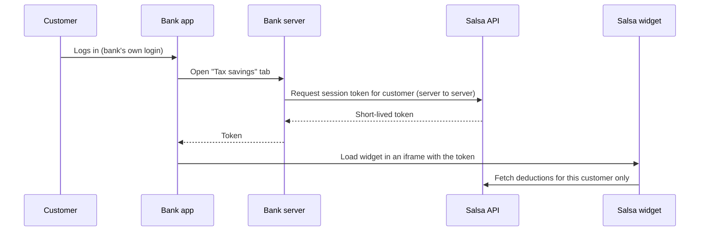

# salsa

Salsa is a tax deduction finder and expense organizer that banks embed in their own app. Every customer gets it automatically, with no separate sign-up, because the bank already has the data salsa needs.

> **Status:** learning and portfolio project. All banks, people and transactions in this repo are fictional. Salsa's numbers are estimates, not tax advice.

## Why a bank, and why everyday consumers

About 90% of taxpayers take the standard deduction, so a list of possible write-offs is useless to most people. Salsa focuses on two things that actually change a tax bill:

1. **Should you itemize?** A running meter that adds up mortgage interest, property tax, donations and medical costs and compares them with the standard deduction for the customer's filing status.
2. **Deductions you get anyway.** Some deductions apply even to people who take the standard deduction, such as interest on a loan for a new US-assembled car, the extra deduction for people 65 and older, and a capped deduction for cash donations.

A bank already knows about the car loan, the interest it charged, the donations, and the customer's age. Salsa turns that into findings without the customer typing anything in.

## How it plugs into a bank



Salsa never sees bank passwords, card numbers or Social Security numbers. Each bank is a separate tenant with its own colors and logo.

## Repo layout

```
apps/
  api/            Fastify + Postgres (Drizzle ORM). Tenants, customers, accounts, transactions.
packages/
  core/           Shared types and helpers: money in cents, dates, account and transaction kinds.
  fixtures/       Deterministic fake bank data: four personas with a full year of transactions.
```

Coming in later phases: `packages/tax-rules`, `packages/categorizer`, `apps/widget`, `apps/demo-bank`.

## Quick start

You need Node 22 or newer and pnpm (`corepack enable` installs the right pnpm version).

```bash
pnpm install
pnpm db:setup        # create tables and load the demo banks and personas
pnpm dev             # API on http://127.0.0.1:3001
curl http://127.0.0.1:3001/health
```

No database install is needed: by default the API runs Postgres inside Node using [PGlite](https://pglite.dev) and stores it in `apps/api/.data`. Stop `pnpm dev` before re-running `pnpm db:seed`, since PGlite allows one process at a time.

To use a real Postgres instead, run `docker compose up -d` and copy `apps/api/.env.example` to `apps/api/.env`, switching `DATABASE_URL` to the Postgres line. A hosted database such as Neon or Supabase works the same way.

## Scripts

| Command | What it does |
| --- | --- |
| `pnpm dev` | Runs the API with auto-reload |
| `pnpm check` | Lint, typecheck and test everything (run before every commit) |
| `pnpm format` | Auto-fixes formatting and import order |
| `pnpm build` | Builds the API into `apps/api/dist` |
| `pnpm db:generate` | Writes a new migration after you change `apps/api/src/db/schema.ts` |
| `pnpm db:migrate` | Applies migrations |
| `pnpm db:seed` | Reloads the demo data. Add `-- --through 2026-10-12` to simulate a year in progress |
| `pnpm fixtures` | Prints a summary of the fake data. Add `-- --json` for everything |

## The demo personas

Each persona is built to exercise a different part of the tax engine. Both demo banks (Tidewater Demo Bank and Summit Demo Credit Union) have all four, with different random details.

| Persona | Situation | What salsa should find |
| --- | --- | --- |
| Maya Brooks | Married homeowner, large mortgage at 6.875%, regular giving | Itemizing should beat the standard deduction |
| Jordan Reyes | Single renter, bought a new US-assembled SUV with a bank loan in March | Car loan interest is deductible even without itemizing |
| Ruth Alvarez | Retiree, 68, home paid off, high medical costs | Senior deduction; medical costs are large but standard deduction still wins |
| Sam Patel | Recent grad, transit commuter, student loans at another servicer | Bank sees payments but not interest, so salsa asks for Form 1098-E |

Each generated transaction also carries a `truthCategory`, the answer key used to test the categorizer. It is never stored in the database, because real bank data doesn't come labeled.

## Design rules

- **Money is integer cents.** Never floating point dollars.
- **Every row has a `tenant_id`**, and composite foreign keys make the database itself reject links across banks. See `apps/api/src/db/schema.ts`.
- **Tax rules are data, per tax year, with sources.** They live in one package so a law change is a reviewed diff, not a hunt through the code.
- **Deterministic fake data.** The same seed always produces the same transactions, so tests and demos are reproducible.

## Roadmap

- [x] **Phase 1: Scaffold.** Monorepo, CI, database schema with tenant isolation, fake data generator, API skeleton.
- [ ] **Phase 2: Tax engine.** `tax-rules` package for tax year 2026 (standard deduction, itemized categories, deductions available to everyone, phase-outs) and a rules-first categorizer measured against the persona answer keys.
- [ ] **Phase 3: Widget.** React dashboard with the itemize meter, findings with confirm/reject, and "estimate, not tax advice" labeling.
- [ ] **Phase 4: Demo bank.** Token handshake, iframe embedding, and two differently branded fake banks.
- [ ] **Phase 5: Polish.** Year-end PDF summary, deployment, architecture diagram and demo video.
