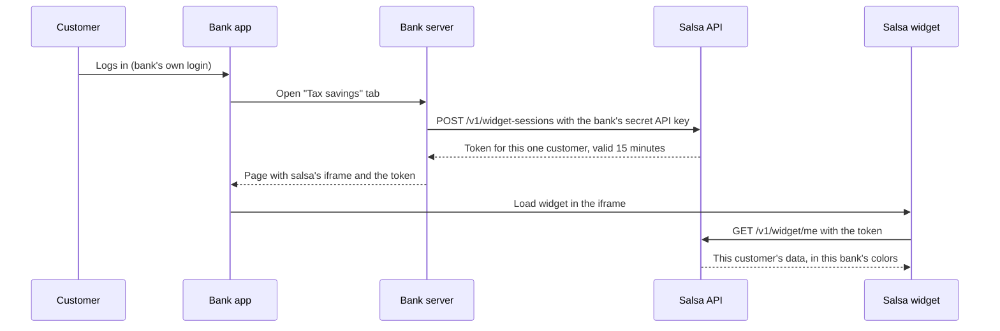
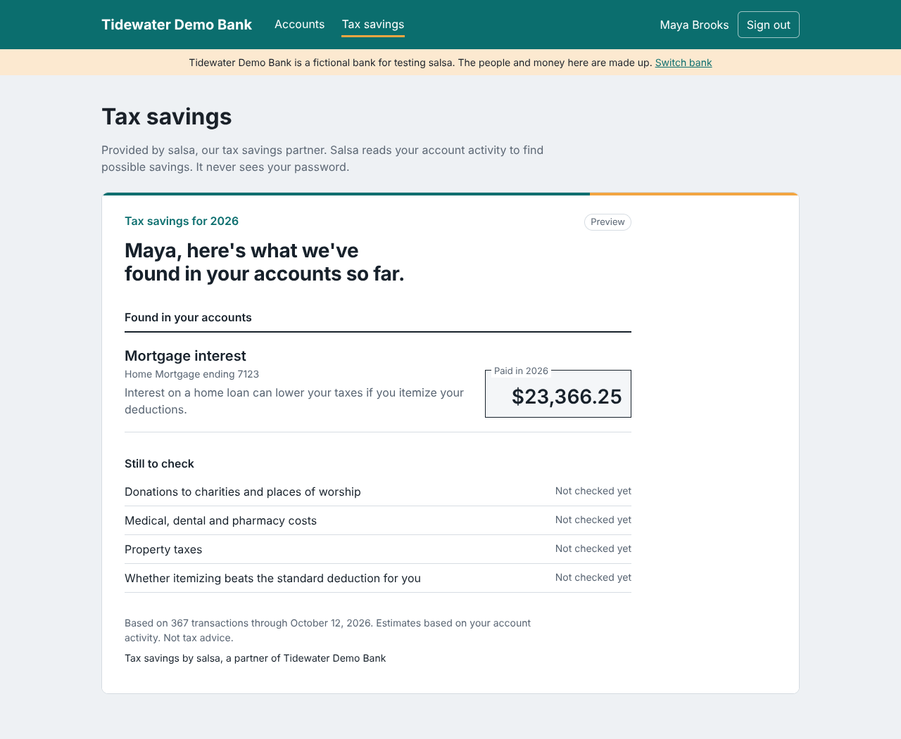

# salsa

Salsa is a white-label financial intelligence service that banks embed in their own online and mobile banking. Its first module, the Opportunity Feed, finds possible tax deductions in a customer's bank activity and guides them to confirm what applies. Customers see it under their bank's brand (by default as "Tax Opportunities"), with no separate sign-up, because the bank already has the data it needs.

Architecture, decision records and the product specification are in [docs](docs/README.md).

> **Status:** learning and portfolio project. All banks, people and transactions in this repo are fictional. Salsa's numbers are estimates, not tax advice.

## Why a bank, and why everyday consumers

About 90% of taxpayers take the standard deduction, so a list of possible write-offs is useless to most people. Salsa focuses on two things that actually change a tax bill:

1. **Should you itemize?** A running meter that adds up mortgage interest, property tax, donations and medical costs and compares them with the standard deduction for the customer's filing status.
2. **Deductions you get anyway.** Some deductions apply even to people who take the standard deduction, such as interest on a loan for a new US-assembled car, the extra deduction for people 65 and older, and a capped deduction for cash donations.

A bank already knows about the car loan, the interest it charged, the donations, and the customer's age. Salsa turns that into findings without the customer typing anything in.

## How it plugs into a bank



Salsa never sees bank passwords, card numbers or Social Security numbers. The bank's API key stays on the bank's server; the browser only ever holds a short-lived token that opens one customer's data. Each bank is a separate tenant with its own colors and logo.

## How testing works before a real bank

Nothing is tested on a live bank. A bank gives a vendor like salsa a **sandbox**: a practice copy of its systems with fake customers. The vendor connects there, the bank's security team reviews it, employees try it, and only then does it reach real customers, usually a small group first.

This repo includes its own sandbox so you can do the same thing on your laptop: two fictional banks with their own websites, sign-in and accounts, each embedding salsa exactly the way a real bank would.



## Repo layout

```
apps/
  api/            Fastify + Postgres (Drizzle ORM). Banks, API keys, customers, accounts, transactions.
  widget/         React panel (Vite) that banks embed in an iframe.
  demo-bank/      Two fake online banks that embed the widget. Local testing only.
packages/
  core/           Shared types and helpers: money in cents, dates, account and transaction kinds.
  fixtures/       Deterministic fake bank data: four personas with a full year of transactions.
```

Coming next: `packages/tax-rules` and `packages/categorizer`.

## Quick start

You need Node 22 or newer and pnpm (`corepack enable` installs the right pnpm version).

```bash
pnpm install
pnpm db:setup        # create tables and load the demo banks and personas (run once)
pnpm dev             # starts everything
```

Then open **http://localhost:4000**, pick a bank, sign in as a customer, and choose **Tax savings**. `pnpm dev` runs three things:

| Address | What it is | In real life |
| --- | --- | --- |
| http://localhost:4000 | The fake banks' websites | The bank's own online banking |
| http://localhost:5173 | The salsa widget | Hosted by salsa, shown inside the bank's page |
| http://127.0.0.1:3001 | The salsa API | Hosted by salsa |

Things to try: sign in as Maya at both banks and notice the same person gets different branding and different data. Sign in as Jordan to see car loan interest. Stop the API and reload Tax savings to see how the bank handles salsa being down.

No database install is needed: by default the API runs Postgres inside Node using [PGlite](https://pglite.dev) and stores it in `apps/api/.data`. Stop `pnpm dev` before re-running `pnpm db:seed`, since PGlite allows one process at a time.

To use a real Postgres instead, run `docker compose up -d` and copy `apps/api/.env.example` to `apps/api/.env`, switching `DATABASE_URL` to the Postgres line. A hosted database such as Neon or Supabase works the same way.

## Scripts

| Command | What it does |
| --- | --- |
| `pnpm dev` | Runs the API, widget and demo banks with auto-reload |
| `pnpm check` | Lint, typecheck and test everything (run before every commit) |
| `pnpm format` | Auto-fixes formatting and import order |
| `pnpm build` | Builds the API and the widget |
| `pnpm db:generate` | Writes a new migration after you change `apps/api/src/db/schema.ts` |
| `pnpm db:migrate` | Applies migrations |
| `pnpm db:seed` | Reloads the demo data up to today. Add `-- --full-year` for the whole year |
| `pnpm fixtures` | Prints a summary of the fake data. Add `-- --json` for everything |

## The demo personas

Each persona is built to exercise a different part of the tax engine. Both demo banks (Tidewater Demo Bank and Summit Demo Credit Union) have all four, with different random details.

| Persona | Situation | What salsa should find |
| --- | --- | --- |
| Maya Brooks | Married homeowner, large mortgage at 6.875%, regular giving | Itemizing should beat the standard deduction |
| Jordan Reyes | Single renter, bought a new US-assembled SUV with a bank loan in March | Car loan interest is deductible even without itemizing |
| Ruth Alvarez | Retiree, 68, home paid off, high medical costs | Senior deduction; medical costs are large but standard deduction still wins |
| Sam Patel | Recent grad, transit commuter, student loans at another servicer | Bank sees payments but not interest, so salsa asks for Form 1098-E |

Each generated transaction also carries a `truthCategory`, the answer key used to test the categorizer. It is never stored in the database, because real bank data doesn't come labeled.

## Design rules

- **Money is integer cents.** Never floating point dollars.
- **Every row has a `tenant_id`**, and composite foreign keys make the database itself reject links across banks. See `apps/api/src/db/schema.ts`.
- **Tax rules are data, per tax year, with sources.** They live in one package so a law change is a reviewed diff, not a hunt through the code.
- **Deterministic fake data.** The same seed always produces the same transactions, so tests and demos are reproducible.

## Roadmap

- [x] **Phase 1: Scaffold.** Monorepo, CI, database schema with tenant isolation, fake data generator, API skeleton.
- [x] **Sandbox.** Two fake banks, bank API keys, the bank-to-Salsa token handshake, and a widget preview showing loan interest.
- [ ] **Phase 2: Opportunity Feed.** Tax rules for 2026, categorizer, tax engine with Verified / Potential / Needs information findings, review workflow, bank configuration and controlled embedding, Discover and My Review. See the [Phase 2 plan](docs/architecture/phase-2-plan.md).
- [ ] **Phase 3: Summary.** Year-at-a-glance comparison, estimated tax effect, documents to keep, document handling.
- [ ] **Phase 4: Bank readiness.** Data feed ingestion, row-level security, rate limits, API reference, retention policies, admin configuration.
- [ ] **Phase 5: Launch polish.** Deployment, demo video, architecture diagrams.
