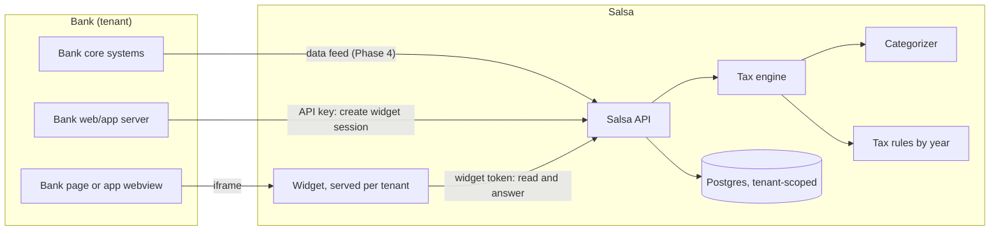

# System overview

## Product shape

Salsa is sold to banks, not to consumers. A bank embeds Salsa in its own online and mobile banking, under its own brand. Customers never create a Salsa account: the bank has already authenticated them, and Salsa only ever sees the customer the bank vouches for.

The first module is the **Opportunity Feed**, which finds possible tax deductions in a customer's bank activity and walks them through confirming them. Later modules (business tax, spending organization, year-end summaries) reuse the same platform: tenancy, sessions, embedding, evidence and review.

## Components and trust boundaries



| Boundary | Who is trusted | Mechanism |
| --- | --- | --- |
| Bank server to Salsa | The bank, for its own customers only | Per-tenant API key, stored only as a SHA-256 hash |
| Bank page to widget | Only pages on the bank's registered origins may embed the widget | `frame-ancestors` per tenant, origin-checked `postMessage` (Phase 2, PR 8) |
| Widget to Salsa | One customer at one bank, for 15 minutes | HMAC-signed widget token naming tenant and customer |
| Person to person | Each person's tax information is private; joint owners and spouses see each other's information only through a shared tax unit both accepted | Separate ownership, visibility and tax unit permissions ([ADR 0010](../decisions/0010-ownership-visibility-and-tax-unit-access.md)) |
| Salsa to database | Every query names a tenant | `tenant_id` on every row, composite foreign keys, later Postgres row-level security |

## Layers inside Salsa

The Opportunity Feed is built in layers with strict one-way dependencies. Each layer is a separate package so it can be tested alone and replaced or extended without touching the others.

```
apps/widget            renders what the API returns; makes no tax decisions
apps/api               auth, tenancy, persistence, snapshots, audit
packages/tax-engine    facts + classifications + tax records  ->  findings
packages/tax-rules     IRS rules per tax year, jurisdiction and taxpayer type, each with sources
packages/categorizer   transaction  ->  what it is (no tax vocabulary)
packages/core          shared types: money, dates, accounts, API contracts
```

- The **categorizer** says what a transaction is ("a payment to a religious organization"). It never says whether anything is deductible ([ADR 0002](../decisions/0002-separate-classification-from-tax-rules.md)).
- The **tax engine** applies a year's **rules** to everything known about a tax unit and produces findings with a derived status ([ADR 0003](../decisions/0003-finding-status-derived-from-evidence.md)). Income-dependent rules use the income measure each rule defines, supplied by the customer and never inferred from deposits ([ADR 0009](../decisions/0009-income-information.md)).
- The **customer's review** is a separate record of what the customer checked, corrected and answered. It never sets a finding's status ([ADR 0004](../decisions/0004-customer-review-separate-from-engine-status.md)).

## Current state (end of Phase 1 and the sandbox)

| Area | What exists |
| --- | --- |
| Tenancy | Tenants, hashed API keys, composite foreign keys on all child tables |
| Integration | `POST /v1/widget-sessions` (bank server) and `GET /v1/widget/me` (widget), 15-minute tokens |
| Data | Customers, accounts (loan terms as JSON), transactions (signed cents, merchant category code, type), loaded by a seed script |
| Widget | React panel themed with bank colors; shows loan interest only; wording hardcoded as "Tax savings" |
| Sandbox | Two fictional banks (`apps/demo-bank`) embedding the widget; end-to-end tests |
| Quality | Tests on every package, CI on every push, migration drift check |

## Known weaknesses and where they are addressed

| # | Weakness | Risk | Addressed |
| --- | --- | --- | --- |
| 1 | Loan interest is summed from transactions instead of using lender tax records (Form 1098, Form 1098-VLI from 2026) | Wrong or unverifiable amounts | Phase 2, PR 4 |
| 2 | Transactions have no pending/posted status and no link from a refund to its original | Refunded donations still count (false positive) | Phase 2, PR 4 |
| 3 | One customer per account; one filer per bank customer assumed; no distinction between owning an account, seeing it, and sharing tax information | Joint accounts and spouses could expose private tax information; future business accounts do not fit | Phase 2, PR 4 and PR 7 ([ADR 0010](../decisions/0010-ownership-visibility-and-tax-unit-access.md)) |
| 4 | Results computed per request and not kept | Cannot show what a customer saw, or why | Phase 2, PR 7 ([ADR 0011](../decisions/0011-saved-review-snapshots.md)) |
| 5 | No ingestion contract; seed script writes tables directly | Every bank integration would be custom | Canonical types in Phase 2 (PR 4); ingestion API and file feeds in Phase 4 |
| 6 | Branding is three values; wording hardcoded | Banks cannot rename the feature or add compliance text | Phase 2, PR 8 ([ADR 0005](../decisions/0005-branding-configuration-is-data.md)) |
| 7 | Any site can embed the widget; `postMessage` targets `*`; fonts load from Google | Clickjacking, data leaving to third parties | Phase 2, PR 8 ([ADR 0006](../decisions/0006-controlled-embedding-and-sessions.md)) |
| 8 | Fixture data is too clean (every charity has the charity code) | Categorizer accuracy would be overstated | Phase 2, PR 4 (hard negative cases) |
| 9 | Tax year is always the current calendar year | January to April, customers need last year | Phase 2, PR 7 |
| 10 | No audit trail of customer answers or corrections | Cannot reconstruct who changed what | Phase 2, PR 7 |
| 11 | No rate limiting, no API reference for bank engineers | Abuse, slow integrations | Phase 4 |
| 12 | Tenant isolation depends on every query remembering its filter | One missed filter leaks another bank's data | Phase 2: one data-access layer (PR 7); row-level security proposed for PR 4 ([ADR 0015](../decisions/0015-database-enforced-tenant-isolation.md)) |
| 13 | Widget tokens cannot be revoked before expiry and carry no session id | A leaked token works for up to 15 minutes; audit records cannot name the session | Phase 2, PR 7: server-side widget sessions |
| 14 | No encryption beyond what the database host provides | Sensitive financial data exposed if storage is compromised | Encryption at rest required before real data; field-level encryption evaluated in Phase 4 |
